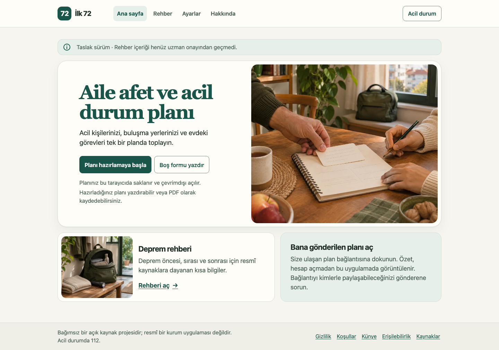

# İlk 72 — Aile Afet Planı

Ailelerin afet ve acil durum planını on dakikada hazırlayıp yazdırabildiği, çevrimdışı çalışan,
hesap gerektirmeyen ve hiçbir veriyi cihaz dışına göndermeyen açık kaynak bir web uygulaması.

> **Durum:** `0.1.0` geliştirme sürümü. Rehber içeriği **taslaktır**; hukuki metinler avukat
> incelemesi bekler ve henüz yayımlanmış bir sürüm yoktur. Üretim derlemesi (`pnpm run build:prod`)
> onaysız içerik varken bilinçli olarak başarısız olur.
>
> **Yayın öncesi doldurulacak yer tutucular (sahibin işi):** `{GITHUB_KULLANICI}` (GitHub
> kullanıcı adı), `{ILETISIM_EPOSTA}` (iletişim e-postası), `{BARINDIRMA_SAGLAYICISI}` (barındırma
> sağlayıcısı). Bu değerler `src/config.ts` içinde tek yerde durur; `{GITHUB_KULLANICI}` ile
> `{ILETISIM_EPOSTA}` doldurulmadan depo adresi, künye ve yasal metinlerdeki iletişim eksik kalır.

## Ekran görüntüsü

<!-- Yayın öncesi: gerçek ekran görüntüsünü `docs/ekran-goruntusu.png` olarak ekleyin ve bu
     yer tutucu bloğunu aşağıdaki görselle değiştirin:
     
-->

> **Yer tutucu:** Ekran görüntüsü yayın öncesi eklenecek — `docs/ekran-goruntusu.png` (henüz yok).
> Görsel eklenince bu blok kaldırılır; başka bir yerden görsel kullanılmaz (İ5).

## Canlı adres

Yayın öncesi doldurulacak: `https://{GITHUB_KULLANICI}.github.io/ilk72/`

Uygulama GitHub Pages üzerinde yalnızca `v*` etiketiyle yayımlanır; `main` dalına yapılan her itiş
canlıya çıkmaz. Yayın için önce `docs/hukuki-inceleme.md` içindeki **Onay tarihi** satırı
doldurulmalı ve bütün rehber içeriği onaylanmalıdır (bkz. §19 ve `docs/icerik-onay.md`).
Barındırma sağlayıcısı kesinleşince `{BARINDIRMA_SAGLAYICISI}` doldurulur ve gizlilik bildirimi
buna göre güncellenir.

## Ne olduğu

İlk 72, bir ailenin afet ve acil durum planını kısa bir soru dizisiyle hazırlayan ve yazdırılabilir
çıktılara dönüştüren bir web uygulamasıdır. Plan, afetten sonraki **ilk 72 saat** için düşünülür.
Uygulama şunları üretir:

- Aile afet planı (A4, yazdırılabilir): kişiler, acil kişiler, buluşma yerleri, toplanma alanı,
  evin güvenli yerleri, vana ve şalter yerleri, görev dağılımı, özel ihtiyaçlar.
- Kişi başı cüzdan kartları, çocuk kartı ve buzdolabı sayfası.
- Hane yapısına göre uyarlanmış afet ve acil durum çantası kontrol listesi.
- Altı aylık gözden geçirme hatırlatması için takvim dosyası.
- Deprem öncesi, anı ve sonrası için resmî kaynaklara dayalı kısa rehber kartları; her kartta
  kaynak bağlantısı ve erişim tarihi.
- Aile üyelerine bağlantı ya da kare kodla aktarılabilen özet kart; tam plan için yedek dosyası.

Uygulama resmî bir kurum uygulaması değildir; resmî tavsiyeyi uygulanabilir bir forma dönüştüren
bağımsız bir araçtır.

## İlkeler (kısa hâli)

Şartnamenin 12 değiştirilemez ilkesi. Ayrıntı ve test karşılıkları: `docs/mimari.md`.

| # | İlke |
|---|---|
| İ1 | **Veri cihazda kalır.** Sunucu, hesap, senkronizasyon, analitik, hata raporlama servisi, çerez yok. Proje sahibi hiçbir kullanıcı verisini göremez. |
| İ2 | **Sıfır dış istek.** Uygulama kendi kökeni dışına ağ isteği yapmaz; dış siteler yalnızca tıklanan bağlantıyla yeni sekmede açılır. |
| İ3 | **Kâğıt önceliklidir.** Afet anında telefon ve şebeke çalışmayabilir; her akış yazdırmaya ya da PDF kaydetmeye götürür. |
| İ4 | **Kaynaksız tavsiye yok.** Her afet tavsiyesi resmî bir kaynağa bağlıdır, kendi cümlelerimizle yazılır, kaynağı ve erişim tarihi gösterilir. |
| İ5 | **Resmî görünme yok.** Kurum adı, logosu, amblemi, kurumsal rengi kullanılmaz; her sayfanın altında bağımsız proje olduğu yazar. |
| İ6 | **Acil servis değildir.** Yardım çağrısı iletmez, uyarı göndermez, haber sunmaz; tek yönlendirme 112'dir. |
| İ7 | **Tıbbi ve teknik talimat yok.** İlk yardım uygulaması, ilaç, bina dayanıklılığı ya da tesisat onarımı anlatılmaz; yetkili kaynağa yönlendirilir. |
| İ8 | **Veri azaltma.** T.C. kimlik no, kimlik/pasaport no, banka, poliçe, parola alanı yoktur; sağlık bilgisi isteğe bağlı ve varsayılan kapalıdır. |
| İ9 | **Sahte güven yok.** "Güvendesiniz", "hazırsınız" gibi ifadeler ve güvenlik puanı yoktur; yalnızca planın hangi bölümlerinin dolu olduğu gösterilir. |
| İ10 | **Herkes için.** WCAG 2.2 AA hedeflenir; büyük punto, sade dil, klavye ve ekran okuyucu desteği vardır; düşük donanımlı telefonlarda çalışır. |
| İ11 | **Para ve tanıtım yok.** Bağış düğmesi, IBAN, reklam, ortaklık bağlantısı, marka adıyla ürün önerisi yoktur. |
| İ12 | **Kullanıcı içeriği yayımlanmaz.** Yorum, forum, harita üzerinde paylaşım, kullanıcıdan kullanıcıya herkese açık içerik yoktur. |

## Ne değildir

- **Resmî bir kurum uygulaması değildir.** Hiçbir kurumla bağlantısı yoktur; kurum adı yalnızca
  kaynak gösterirken düz metin olarak geçer.
- **Acil yardım hizmeti değildir.** Yardım çağırmaz, uyarı göndermez, anlık bilgi sunmaz. Acil
  durumda **112**'yi arayın.
- **Tıbbi, hukuki, mühendislik ya da sigorta danışmanlığı değildir.** İlk yardım yöntemi, ilaç,
  bina risk değerlendirmesi veya poliçe tavsiyesi vermez; ilgili yetkili kaynağa yönlendirir.
- **Bir hesap ya da bulut hizmeti değildir.** Üyelik, giriş, senkronizasyon, cihazlar arası aktarım
  yoktur.
- **Bir veri toplama aracı değildir.** Sunucu, veritabanı, günlük erişimi, telemetri ya da çerez
  yoktur.
- **Toplanma alanı verisi sunmaz.** Resmî sorgudan öğrenilen bilgi kullanıcı tarafından elle
  yazılır; harita veya otomatik veri çekme yoktur.
- **Ticari değildir.** Satış, reklam, sponsorluk, bağış ya da IBAN yoktur.

## Nasıl kullanılır

1. Uygulamayı tarayıcıda açın. İlk açılışta kısa bir bilgilendirme kutusu çıkar; kabul edince
   sihirbaz başlar.
2. Dokuz adımı sırayla doldurun: hane bilgileri, kişiler, acil kişiler, buluşma yerleri, toplanma
   alanı, evin güvenli yerleri, vana ve şalter, görev dağılımı, özel ihtiyaçlar.
3. Özet sayfasında planın hangi bölümlerinin dolu olduğunu görün. Eksik bölümler için sihirbaza
   dönebilirsiniz.
4. **Yazdır** sayfasından aile planını, cüzdan ve çocuk kartlarını, buzdolabı sayfasını, çanta
   listesini ya da boş formu yazdırın veya PDF olarak kaydedin. Kâğıt kopyayı çantanıza ve
   buzdolabınıza koyun (İ3).
5. Uygulamayı ana ekrana ekleyin; ilk ziyaretten sonra internet olmadan da çalışır. Ayarlar
   sayfasında "Ana ekrana nasıl eklenir?" açıklaması vardır.
6. Planı aile üyeleriyle paylaşmak için özet kartı bağlantı ya da kare kod olarak gönderin. Özet,
   paylaşıldığı andaki hâlin kopyasıdır. Tam plan için yedek dosyasını indirin.
7. Planı altı ayda bir gözden geçirin; takvim dosyasını indirerek hatırlatma ekleyin.
8. Ayarlar sayfasındaki "Bütün verilerimi sil" düğmesi bu cihazdaki her şeyi kalıcı olarak siler.

## Gizlilik özeti

- Planınıza yazdığınız her şey (adlar, telefonlar, adres, isterseniz sağlık bilgileri) **yalnızca bu
  cihazdaki tarayıcı deposunda** saklanır. Bize ya da başka birine gönderilmez.
- Sunucumuz, üyelik sistemimiz, veritabanımız, çerezimiz, analitiğimiz ya da izleme aracımız yoktur.
- Uygulamanın dosyaları bir barındırma sağlayıcısı üzerinden sunulur. Her internet sitesinde olduğu
  gibi sağlayıcı, sayfayı açtığınızda IP adresinizi ve tarayıcı bilginizi kendi kayıtlarına
  yazabilir; bu kayıtlara erişemeyiz. Sağlayıcı ve bu kayıtlar gizlilik bildiriminde yazılıdır.
- Paylaşım bağlantısındaki bilgiler bağlantının `#` sonrasındaki parçasında taşınır; bu parça
  sunucuya gönderilmez. Bağlantıyı gören herkes içeriğini okuyabilir; parola koyabilirsiniz.
- Ayrıntılı metin: uygulama içindeki **Gizlilik Bildirimi** (`#/gizlilik`) ve
  `LICENSE`/`LICENSE-CONTENT` dosyaları.

## İçerik ve kaynak politikası

- **Kaynaksız tavsiye yok (İ4).** Kullanıcıya gösterilen her afet tavsiyesi, resmî bir kaynağa bağlı
  bir içerik maddesidir; her maddede kaynağın adı, adresi ve erişim tarihi gösterilir.
- **Kendi cümlelerimizle.** Kurum metinleri, görselleri, afişleri ve amblemleri kopyalanmaz;
  metinler kendi cümlelerimizle özetlenir. Kaynak yalnızca düz metin olarak anılır.
- **İzinli alan adları.** Dış bağlantılar yalnızca şu resmî alan adlarına ve alt alan adlarına
  verilir: `afad.gov.tr`, `turkiye.gov.tr`, `112.gov.tr`, `icisleri.gov.tr`, `saglik.gov.tr`,
  `aile.gov.tr`, `dask.gov.tr`, `kizilay.org.tr`, `mevzuat.gov.tr`, `resmigazete.gov.tr`,
  `kvkk.gov.tr`.
- **Onay kapısı.** Her madde, kaynağıyla karşılaştırılıp `onayli` yapılana kadar `taslak` dur.
  `content:check` kaynak zorunluluğunu, adres kurallarını, metin uzunluğunu ve inceleme
  alanlarını denetler; `build:prod` taslak madde kaldıysa başarısız olur.
- **Düzeltme yolu.** Rehber kartlarındaki "Hata bildir" bağlantısı ya da Künye sayfasındaki
  e-posta ile yanlış veya eskimiş içerik bildirilir. İçerik hataları için depodaki "Yanlış veya
  eskimiş içerik" sorun şablonu kullanılır; **resmî kaynak adresi zorunludur**.
- **Güncellik.** İncelemeler yılda bir ve büyük bir afetten sonra yinelenir; 12 ayı geçen inceleme
  uyarı, 18 ayı geçen inceleme üretim derlemesini durdurur. Ayrıntı: `docs/icerik-onay.md`.
- **Sınırlar.** Rehber yalnızca depremi kapsar; tıbbi ya da teknik talimat içermez; yetkililerin
  talimatlarının yerini tutmaz.

## Nasıl katkı verilir

- Kurulum, kalite kapısı ve içerik önerme kuralları: [CONTRIBUTING.md](CONTRIBUTING.md).
- Davranış kuralları: [CODE_OF_CONDUCT.md](CODE_OF_CONDUCT.md).
- Güvenlik açıkları herkese açık sorun olarak değil, özelden bildirilir: [SECURITY.md](SECURITY.md).
- Hata, içerik hatası, erişilebilirlik engeli ve öneri için depodaki sorun şablonlarını kullanın.
- İlkeleri delen öneriler (bağış, reklam, hesap, telemetri, dış istek, resmî amblem vb.)
  değerlendirilmez.

Yerel geliştirme kısa yolu:

```powershell
pnpm install --frozen-lockfile
pnpm run dev
pnpm run check
```

## Lisanslar

- **Kod:** MIT — [LICENSE](LICENSE).
- **Rehber metinleri ve belgeler:** CC BY 4.0 — [LICENSE-CONTENT](LICENSE-CONTENT).
- **Üçüncü taraf bağımlılıklar:** [THIRD_PARTY_LICENSES.md](THIRD_PARTY_LICENSES.md).
- Proje bağış kabul etmez ve `FUNDING.yml` dosyası bilinçli olarak yoktur (İ11).

## Bilinen sınırlar

1. Uygulama plan yapmayı kolaylaştırır; çantayı hazırlamak, eşyaları sabitlemek ve tatbikat yapmak kullanıcıya kalır.
2. Rehber yalnızca depremi kapsar; diğer afetler için resmî kaynaklara bakılmalıdır.
3. Toplanma alanı bilgisi uygulamada yoktur; kullanıcı resmî sorgudan öğrenip kendisi yazar ve zaman zaman yeniden kontrol etmelidir.
4. Veri yalnızca tek cihazdadır; cihaz kaybolur ya da tarayıcı verisi silinirse plan da gider. Yedek dosyası ve basılı kopya bu yüzden önemlidir.
5. Paylaşılan özet o andaki halin kopyasıdır; sonradan yapılan değişiklikler karşı tarafa kendiliğinden gitmez.
6. Uygulama kilidinin parolası unutulursa veri kurtarılamaz.
7. İçerik resmî tavsiyelerin özetidir; resmî kaynaklar değiştiğinde güncellenene kadar eski kalabilir.
8. Bağımsız ve gönüllü bir projedir; sürekliliği garanti edilmez. Açık kaynak olduğu için başkaları sürdürebilir.
